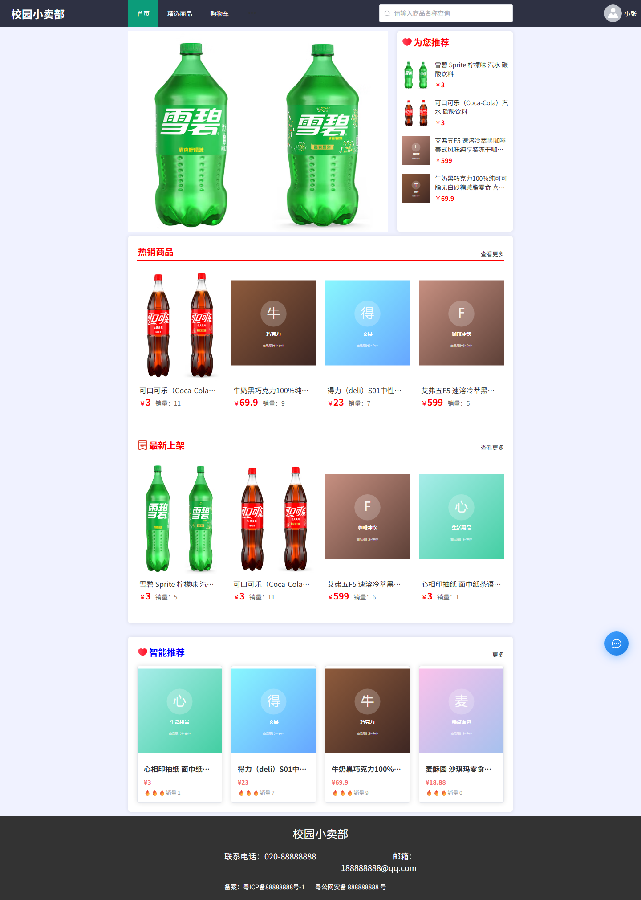
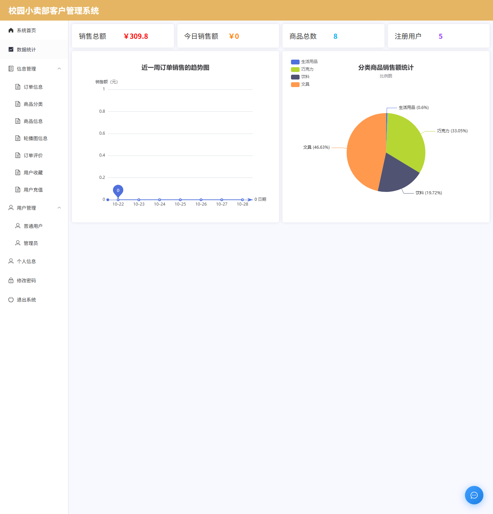
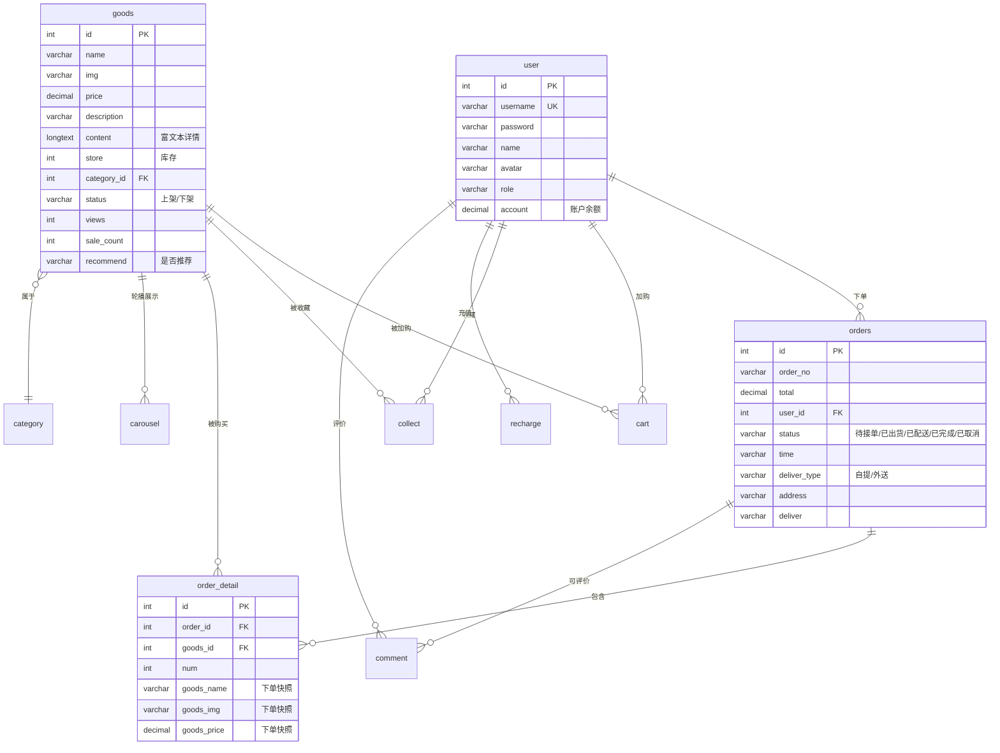

# 校园小卖部客户管理系统（Campus Store CRM）

以**校园小卖部**为业务场景的客户管理与线上交易系统，前后端分离架构，包含**前台用户端**、**后台管理端**，
并额外集成两个智能服务：**基于协同过滤的商品推荐**（Python + FastAPI）和 **AI 智能客服**（Spring AI + DeepSeek + SSE 流式对话）。

> 毕业设计项目 · 独立完成需求分析、库表设计、前后端开发与部署联调

---

## 效果预览

| 前台首页（轮播 / 热销 / 最新 / 智能推荐） | 后台数据看板（ECharts） |
| --- | --- |
|  |  |


---

## 目录

- [效果预览](#效果预览)
- [功能清单](#功能清单)
- [技术栈](#技术栈)
- [系统架构](#系统架构)
- [数据库设计](#数据库设计)
- [目录结构](#目录结构)
- [快速开始](#快速开始)
- [常见问题排查](#常见问题排查)
- [关键实现说明](#关键实现说明)
- [接口约定](#接口约定)
- [已知限制与后续计划](#已知限制与后续计划)
- [开发历程](#开发历程)

---

## 功能清单

### 前台（学生用户）

| 模块 | 说明 |
| --- | --- |
| 注册 / 登录 | 区分「普通用户」与「管理员」两种角色，登录后按角色跳转不同端 |
| 首页 | 轮播图、热销商品（按销量）、最新上架、为您推荐（运营标品）、智能推荐（算法） |
| 商品浏览 | 分类导航 + 关键词搜索 + 分页 |
| 商品详情 | 图片/价格/库存/富文本详情、商品评价分页展示、收藏与取消收藏 |
| 购物车 | 数量增减、删除、勾选结算、总价实时计算 |
| 下单 | 自提 / 外送二选一（外送需填地址）、余额支付 |
| 我的订单 | 状态筛选、取消订单（退款 + 库存回滚）、确认收货、评价打分 |
| 个人中心 | 修改资料、上传头像、修改密码 |
| 充值 | 微信 / 支付宝模拟充值，实时到账并记录流水 |
| AI 客服 | 右下角悬浮窗口，流式回答，支持多轮上下文 |

### 后台（管理员）

| 模块 | 说明 |
| --- | --- |
| 数据看板 | 销售总额 / 今日销售额 / 商品总数 / 注册用户数 + 近 7 日销售趋势折线图 + 分类销售额饼图 |
| 用户管理 | 列表、搜索、编辑、删除 |
| 管理员管理 | 多管理员账号维护 |
| 商品分类 | 分类增删改查 |
| 商品管理 | 富文本编辑、多图上传、上架/下架、设为推荐、库存与销量维护 |
| 轮播图管理 | 上传图片并关联商品，点击跳转详情 |
| 订单管理 | 查看订单与明细、流转状态（待接单 → 已出货 / 已配送 → 已完成）、填写配送信息 |
| 评价管理 | 集中查看/删除用户评价 |
| 充值记录 | 查看所有用户充值流水 |
| 收藏管理 | 查看用户收藏数据 |

---

## 技术栈

| 分层 | 技术 | 版本 |
| --- | --- | --- |
| 后端框架 | Spring Boot | 3.3.1 |
| 运行环境 | JDK | 21 |
| 持久层 | MyBatis + PageHelper | 3.0.3 / 1.4.6 |
| 数据库 | MySQL | 8.x |
| 工具库 | Hutool | 5.8.25 |
| 大模型接入 | Spring AI（OpenAI 兼容协议，对接 DeepSeek） | 1.0.0 |
| 前端框架 | Vue | 3.3.4 |
| UI 组件库 | Element Plus | 2.8.4 |
| 构建工具 | Vite（前端）/ Maven（后端） | 4.x / 3.9 |
| 图表 | ECharts | 6.x |
| 富文本 | wangEditor | 5.x |
| 推荐服务 | Python + FastAPI + implicit（ALS）/ scipy + joblib | — |

> 说明：全局登录态使用 `localStorage` 保存用户对象，未引入 JWT / Spring Security / Pinia，属于教学型实现的简化取舍（见「已知限制」）。

---

## 系统架构

```
┌──────────────────────────────────────────────────────────────┐
│                        浏览器（Vue 3 SPA）                     │
│   Element Plus · Vue Router · Axios · ECharts · EventSource   │
└───────────────┬──────────────────────────┬───────────────────┘
                │  HTTP / JSON             │  SSE（AI 客服流式）
                ▼                          ▼
┌──────────────────────────────────────────────────────────────┐
│                   Spring Boot 3.3.1（:9090）                  │
│  Controller ── Service ── Mapper(MyBatis) ── MySQL           │
│      │                                                        │
│      ├─ ChatController        →  Spring AI → DeepSeek 大模型   │
│      ├─ RecommendService      →  Python 推荐服务（:8000）      │
│      └─ FileController        →  本地磁盘 files/ 上传下载       │
└───────────────┬──────────────────────────────────────────────┘
                │ JDBC
                ▼
        ┌───────────────┐         ┌────────────────────────────┐
        │  MySQL 8      │         │  Python FastAPI（:8000）    │
        │  code2026 库  │◄────────│  implicit ALS / Item-CF     │
        │  11 张表      │  读行为  │  训练产物 artifacts/*.joblib │
        └───────────────┘  数据   └────────────────────────────┘
```

三条典型链路：

1. **标准业务流**：前端 → `Controller` → `Service` → `Mapper` → MySQL → 统一 `Result` JSON 返回
2. **智能推荐流**：前端 `/web/recommend` → `RecommendService` → Python 服务算出商品 ID → 回查 MySQL 拿完整商品信息 → 返回（**失败自动降级为热销商品**）
3. **AI 客服流**：前端 `EventSource` → `ChatController` 用 `SseEmitter` → Spring AI 流式调用 DeepSeek → 逐 token 推送给前端渲染

---

## 数据库设计

共 11 张表：



两个值得说明的设计：

- **订单明细做商品快照**：`order_detail` 冗余存了商品名、图片、单价。这样商品改价或下架，历史订单显示的内容不受影响。
- **余额与充值分离**：`user.account` 是当前余额，`recharge` 是流水记录。下单扣 `account`，取消订单加回 `account`，充值同时写流水 + 加余额，全部在同一个事务里。

---

## 目录结构

```
code2026/
├── springboot/                      # 后端
│   ├── src/main/java/com/example/
│   │   ├── common/                  # Result 统一响应、CorsConfig、AppConfig(RestTemplate)
│   │   ├── controller/              # 15 个 REST 控制器
│   │   ├── entity/                  # 12 个实体类
│   │   ├── exception/               # 自定义异常 + 全局异常处理
│   │   ├── mapper/                  # MyBatis Mapper 接口
│   │   ├── service/                 # 业务层（下单事务、推荐调用等）
│   │   └── utils/CopyUtils.java     # 代码生成小工具
│   └── src/main/resources/
│       ├── application.yml          # 主配置（无密钥，全部环境变量占位）
│       ├── application-local.yml    # 本地配置（已在 .gitignore，写明文密码）
│       └── mapper/*.xml             # 11 个 MyBatis XML
├── vue/                             # 前端
│   └── src/
│       ├── api/                     # 推荐接口封装
│       ├── components/AiChat.vue    # AI 客服组件
│       ├── router/index.js          # 路由（/manager 后台，/front 前台）
│       ├── utils/request.js         # Axios 封装与拦截器
│       └── views/
│           ├── manager/             # 后台 12 个页面
│           └── front/               # 前台 10 个页面
├── python_recommend/                # 推荐服务
│   ├── recommend_implicit.py        # 从 MySQL 训练模型
│   ├── api_implicit.py              # FastAPI 推理服务
│   └── requirements.txt
├── sql/code2026.sql                 # 建库建表 + 演示数据
├── files/                           # 上传文件存储目录
└── .gitignore
```

---

## 快速开始

### 环境要求

| 依赖 | 版本 |
| --- | --- |
| JDK | 21 |
| Maven | 3.9+ |
| MySQL | 8.0+ |
| Node.js | 18+ |
| Python | 3.10 ~ 3.12（仅推荐服务需要） |

### 一键启动（推荐）

最省事的方式：**双击项目根目录下的 `启动系统.bat`**。

它会调用 `run/start-all.ps1`，按依赖顺序启动 **MySQL → 推荐服务 → 后端 → 前端**，
已经在跑的服务自动跳过，最后打印地址汇总。停止用 `停止系统.bat`。

命令行等价写法：

```powershell
cd code2026
powershell -ExecutionPolicy Bypass -File run\start-all.ps1            # 启动（跳过已运行的）
powershell -ExecutionPolicy Bypass -File run\start-all.ps1 -Restart   # 全部重启
```

也可以单独启动某一个：`run\start-backend.cmd`、`run\start-frontend.cmd`、`run\start-recommend.cmd`。

> ⚠️ 不要直接双击 `.ps1` —— Windows 默认会用记事本打开它，而且可能被"执行策略"拦住。
> 要么用上面的 `.bat`，要么按上面的 `powershell -ExecutionPolicy Bypass -File` 方式运行。

### 1. 初始化数据库

**cmd 里**（可以用 `<` 重定向）：

```bat
mysql -u root -p -e "CREATE DATABASE IF NOT EXISTS code2026 DEFAULT CHARACTER SET utf8mb4 COLLATE utf8mb4_unicode_ci;"
mysql -u root -p code2026 < sql\code2026.sql
```

**PowerShell 里**（**不支持 `<` 重定向**，必须用 `source`，这是很多人第一步就卡住的原因）：

```powershell
mysql -u root -p -e "CREATE DATABASE IF NOT EXISTS code2026 DEFAULT CHARACTER SET utf8mb4 COLLATE utf8mb4_unicode_ci;"
mysql -u root -p code2026 -e "source sql/code2026.sql"
```

> 注意 `source` 后面的路径要用 `/`（或转义的 `\\`），不能用反斜杠。

### 2. 配置密钥

复制 `springboot/src/main/resources/application-local.yml` 模板，填入你自己的配置（该文件已被 `.gitignore` 忽略）：

```yaml
spring:
  ai:
    openai:
      api-key: sk-你的DeepSeek密钥
  datasource:
    password: 你的数据库密码
```

也可以完全不用配置文件，改用环境变量：

```bash
DEEPSEEK_API_KEY=sk-xxx
DB_PASSWORD=123456
RECOMMEND_SERVICE_URL=http://localhost:8000/recommend
```

### 3. 启动后端

> ⚠️ **工作目录必须是 `code2026/`**，因为文件上传/下载用的是 `System.getProperty("user.dir") + "/files/"`
> （数据库里存的历史图片路径都指向这个目录）。

```bash
cd code2026
mvn -f springboot/pom.xml clean package -DskipTests
java -jar springboot/target/springboot-0.0.1-SNAPSHOT.jar
```

也可以直接双击 `run/start-backend.cmd`（会自动定位 JDK、切到正确工作目录）。

后端启动在 <http://localhost:9090>。

### 4. 启动前端

```bash
cd code2026/vue
npm install
npm run dev
```

或双击 `run/start-frontend.cmd`。打开 <http://localhost:5173>。
开发环境接口地址由 `vue/.env.development` 的 `VITE_BASE_URL` 指定。

### 5. 启动推荐服务（可选）

不启动也能用——`RecommendService` 会自动降级为热销商品。

```bash
cd code2026/python_recommend
python -m venv .venv && .venv/Scripts/activate     # Windows
pip install -r requirements.txt
python recommend_implicit.py                        # 从 MySQL 真实行为训练
uvicorn api_implicit:app --host 0.0.0.0 --port 8000
```

或双击 `run/start-recommend.cmd train` 训练、`run/start-recommend.cmd` 启动服务。

验证：

```bash
curl -X POST http://localhost:8000/recommend -H "Content-Type: application/json" -d "{\"user_id\":12,\"top_n\":4}"
```

---

### 6. 本地运行验证记录

以下结果是在真实环境（Windows 11 + JDK 21 + MySQL 8.0.28 + Node 24 + Python 3.12）下逐项跑通后记录的，不是"理论上可以"：

| 服务 | 端口 | 状态 |
| --- | --- | --- |
| Spring Boot 后端 | 9090 | ✅ |
| Vue 前端（Vite） | 5173 | ✅ |
| Python 推荐服务 | 8000 | ✅ |
| MySQL | 3306 | ✅ |

接口实测（数据与 `sql/code2026.sql` 完全一致）：

| 接口 | 结果 |
| --- | --- |
| `POST /login`（admin/admin，管理员） | `code=200`，role=管理员 |
| `POST /login`（aaa/123，用户） | `code=200`，id=12，account=458.30 |
| `GET /goods/selectAll` | 8 条，带 categoryName 关联 |
| `GET /category/selectAll` | 9 条 |
| `GET /carousel/selectAll` | 2 条 |
| `GET /orders/selectPage` | total=9 |
| `GET /count` | 销售总额 309.80 / 商品 8 / 用户 5 |
| `GET /selectLine` | 近 7 天 |
| `GET /selectPie` | 4 个有销售额的分类 |
| `GET /comment/selectAll` | 3 条 |
| `GET /recharge/selectAll` | 5 条 |
| `GET /collect/selectAll` | 4 条 |
| `GET /files/download/{name}` | 已有图片文件返回 200 |
| CORS 预检（Origin: 5173） | `Access-Control-Allow-Origin: *` |

推荐链路实测：

| 场景 | 结果 |
| --- | --- |
| 训练（真实行为：5 购买 + 4 收藏 + 3 评价 = 7 条交互，2 用户 / 6 商品） | 输出 `algo=als`，2.89s |
| `POST :8000/recommend` user=12 top_n=2 | `source=als`，ids=`3,2` |
| `POST :8000/recommend` user=999（无行为） | `source=cold_start`，ids=`7,3,4,6`（热门兜底） |
| `GET :9090/web/recommend?userId=12`（Java 转发） | ids=`3,2` —— 与 Python 一致，**说明跨语言调用真正生效** |
| 关掉 Python 服务后再请求 `/web/recommend` | ids=`7,3`（销量最高的两个）—— **降级生效** |

### 7. 默认账号

| 角色 | 账号 | 密码 |
| --- | --- | --- |
| 管理员 | admin | admin |
| 普通用户 | aaa | 123 |
| 普通用户 | bbb | 123 |

---

## 常见问题排查

这一节是"照着文档跑不起来"时的对照表，全部来自实际踩过的坑。

| 现象 | 原因 | 解决 |
| --- | --- | --- |
| **点"登录"没任何反应**（不跳转、也不报错） | ① 后端没启动，请求直接失败；② 前端登录代码原来**没有 catch**，网络失败时静默 | ① 后端起没起：浏览器打开 <http://localhost:9090/count> 看有没有 JSON；② 已修复：现在会明确提示"无法连接后端服务，请确认后端已启动" |
| 登录提示"**管理员账号不存在**，请确认账号…" | 登录页上方的**角色下拉选错了**（选成了"普通用户"） | `admin` 必须把角色选成「管理员」；`aaa/123` 必须选「普通用户」。提示语已带上这个线索 |
| 登录提示"**密码错误**…" | 密码不对。管理员默认 `admin`，普通用户默认 `123` | ① 点密码框右侧的 👁 图标**把密码显示出来核对**；② 前后空格已在前后端自动 `trim`，但仍要小心**中文输入法打出全角字符**或**大小写**；③ 实在不行一键重置：`powershell -ExecutionPolicy Bypass -File run\reset-admin-password.ps1`（可加 `-Username aaa -Password 123 -Table user` 重置普通用户） |
| **页面突然打不开 / 白屏**，Vite 窗口已退出 | 编辑器保存文件时在 `src` 下生成 `.xxx.tmpdir` 临时文件，chokidar 监听它抛 `EBUSY`，把 Vite 进程带崩 | 已在 `vite.config.js` 里 `server.watch.ignored` 排除临时文件；遇到就重跑 `启动系统.bat` |
| `'java' / 'mvn' / 'mysql' 不是内部或外部命令` | 用的是**免安装版**工具链（`D:\dsh-tools`），没有注册到系统 PATH | 已把 JDK / Maven / MySQL 的 `bin` 目录写入**用户级 PATH**，**关掉终端重开**即可生效；或直接用 `启动系统.bat`（脚本内部自己定位路径，不依赖 PATH） |
| 双击 `.ps1` 弹记事本 / 报"禁止运行脚本" | Windows 默认把 `.ps1` 关联到记事本；且默认执行策略是 Restricted | 用 `启动系统.bat`，或 `powershell -ExecutionPolicy Bypass -File run\start-all.ps1` |
| `mysql ... < sql\code2026.sql` 报语法错误 | **PowerShell 不支持 `<` 输入重定向** | 改用 `mysql -u root -p code2026 -e "source sql/code2026.sql"` |
| 后端启动几秒后**静默退出**，没有异常日志（只有一行 `Stopping service [Tomcat]`） | 某些受限环境（沙箱/容器）在容器启动阶段会因线程/临时目录限制被外部终止 | 加 `--spring.main.lazy-initialization=true`（`启动系统.bat` 已内置） |
| 前端图片一片空白 | ① 文件下载接口没设 `Content-Type`，SVG 在 `` 里不渲染；② `files/` 里的历史图片丢失 | ① 已修复（按扩展名推断 MIME 并设为 inline）；② 见「已知限制」 |
| `npm run build` 报 `spawn EPERM` 或 `remove ... Access is denied` | `%TEMP%` 目录权限异常，esbuild 无法在临时目录创建/清理文件 | 把 `TMP`/`TEMP` 指向可写目录（已写入用户环境变量，指向 `D:\dsh-tools\tmp`） |
| MySQL 启动报 `errno: 13 Unable to create temporary file` | 同上，`%TEMP%` 不可写 | 启动时加 `--tmpdir=` 指向可写目录（`run\start-all.ps1` 已处理） |
| 端口被占用（9090 / 8000 / 5173 / 3306） | 有残留进程 | 双击 `停止系统.bat`，或 `run\stop-all.ps1` |
| 页面能开但数据全空 | 数据库没导入，或 `application-local.yml` 里数据库密码不对 | 检查 `mysql -u root -p -e "select count(*) from code2026.goods"`；核对 `application-local.yml` |
| AI 客服不回复 | 没有网络 / API Key 无效 / 余额不足 | 检查 `application-local.yml` 的 `api-key`；浏览器 F12 看 `/api/chat/stream` 请求 |

---

## 关键实现说明

### 1. 下单事务：一个 `@Transactional` 里的五件事

`OrdersService.add()` 把「库存校验 → 扣库存 → 加销量 → 写订单明细 → 扣余额 → 清购物车」放在同一个事务里，
任何一步失败（库存不足、余额不足）都会整体回滚，不会出现「钱扣了订单没生成」的脏数据。
取消订单走 `updateById()`，做**逆向补偿**：退钱、库存加回、销量减掉。

### 2. 智能推荐 + 柔性降级

`RecommendService` 调 Python 服务拿商品 ID，再回查数据库。**任何异常都只打日志不抛错**，直接降级：

```java
try {
    // POST 到 FastAPI，拿 recommended_item_ids
} catch (Exception e) {
    log.warn("调用推荐服务失败，将降级为热销商品：{}", e.getMessage());
}
return goodsService.getHotGoods(topN);   // 兜底
```

`RestTemplate` 显式设置了连接 1.5s / 读取 2.5s 超时（默认是无限等待，会拖垮线程池）。

训练脚本的数据全部来自真实业务表：购买（权重 3.0 × 件数）、收藏（2.0）、评价（1.5）、加购（1.0），
构建「用户 × 商品」稀疏矩阵后用 ALS 分解。装不上 `implicit` 时自动降级为纯 numpy 的 Item-CF，保证一定能跑通。

### 3. AI 客服：SSE 流式 + 多轮记忆

- 后端 `ChatController` 用 `SseEmitter` + `produces = TEXT_EVENT_STREAM_VALUE`
- `MessageChatMemoryAdvisor` + `MessageWindowChatMemory(maxMessages=20)` 实现滑动窗口多轮记忆，控制 token 成本
- `CHAT_MEMORY_CONVERSATION_ID` 用前端生成的 `crypto.randomUUID()` 区分不同会话
- 前端用原生 `EventSource` 逐 token 追加 + `markdown-it` 渲染，实现打字机效果
- System Prompt 明确约束了「能做什么 / 不能做什么 / 回答风格」，把客服限定在系统使用范围内

### 4. 数据看板

后端 `/count`、`/selectLine`、`/selectPie` 三个统计接口，前端用 ECharts 画折线图（近 7 日，带最大/最小/均值标记）和饼图（分类销售占比）。
统计时统一排除了「已取消」订单。

---

## 接口约定

所有接口统一返回：

```json
{ "code": "200", "msg": "请求成功", "data": {} }
```

| code | 含义 |
| --- | --- |
| 200 | 成功 |
| 500 | 业务异常（`msg` 字段为可直接展示给用户的中文提示） |

前端 `utils/request.js` 统一做了响应拦截与错误提示，业务代码里只关心 `res.data`。

---

## 已知限制与后续计划

这些是明确的、有意为之的取舍，不是 bug：

| 限制 | 说明 | 后续计划 |
| --- | --- | --- |
| **部分商品图是占位图** | 磁盘故障导致 `files/` 里的历史图片丢失：SQL 引用的 24 个文件只剩 2 个。已为缺图的商品生成同名 SVG 占位图（`files/goods-*.svg`），轮播图已改为指向现存商品图，界面不再出现破图；真实照片需要重新上传 | 在后台「商品管理 → 编辑 → 上传图片」补图即可 |
| **受限环境启动** | 在部分沙箱/容器环境中，容器启动阶段进程会静默退出（Bean 初始化期间被外部终止）。加 `--spring.main.lazy-initialization=true` 可正常启动，普通开发机不需要 | 已内置在 `run/start-all.ps1` / `启动系统.bat` |
| 无鉴权体系 | 登录态存 `localStorage`，密码明文存储，接口无拦截器 | 引入 Spring Security + JWT + BCrypt |
| 无支付对接 | 充值是模拟写入流水，未接入真实支付网关 | 接入沙箱支付 |
| 推荐数据量小 | 演示数据只有 2 个用户有行为、6 个商品可推荐，ALS 隐因子维度设得较小 | 扩充行为数据后调参、增加离线评估（Recall@K） |
| 单机文件存储 | 上传文件存本地 `files/` 目录 | 迁移到 OSS / MinIO |
| 无缓存 | 首页每次请求都查库 | 引入 Redis 缓存热点数据 |
| 无自动化测试 | 仅做了手工黑盒用例 | 补 JUnit + MockMvc / Vitest |

---

## 开发历程

| 阶段 | 内容 |
| --- | --- |
| 2025.11 上旬 | 搭建前后端骨架，打通跨域、统一响应、Axios 封装 |
| 2025.11 中旬 | 设计 11 张表；先做一个样板模块跑通 MyBatis + PageHelper，再写 `CopyUtils` 批量生成其余模块 |
| 2025.11 ~ 12 | 打通交易闭环：购物车 → 下单事务 → 订单状态流转 → 充值 → 评价 |
| 2025.12.05 | 数据库导出备份 |
| 2026.02 ~ 03 | 集成 AI 客服（Spring AI + SSE）、数据看板、推荐服务 |
| 2026.04 | 补充演示数据、打磨交互细节 |
| 2026.05 | 撰写论文、制作答辩 PPT |

---

## 致谢

感谢指导教师的指导；项目开发过程中借助了 AI 编程工具辅助排查问题与生成样板代码。
